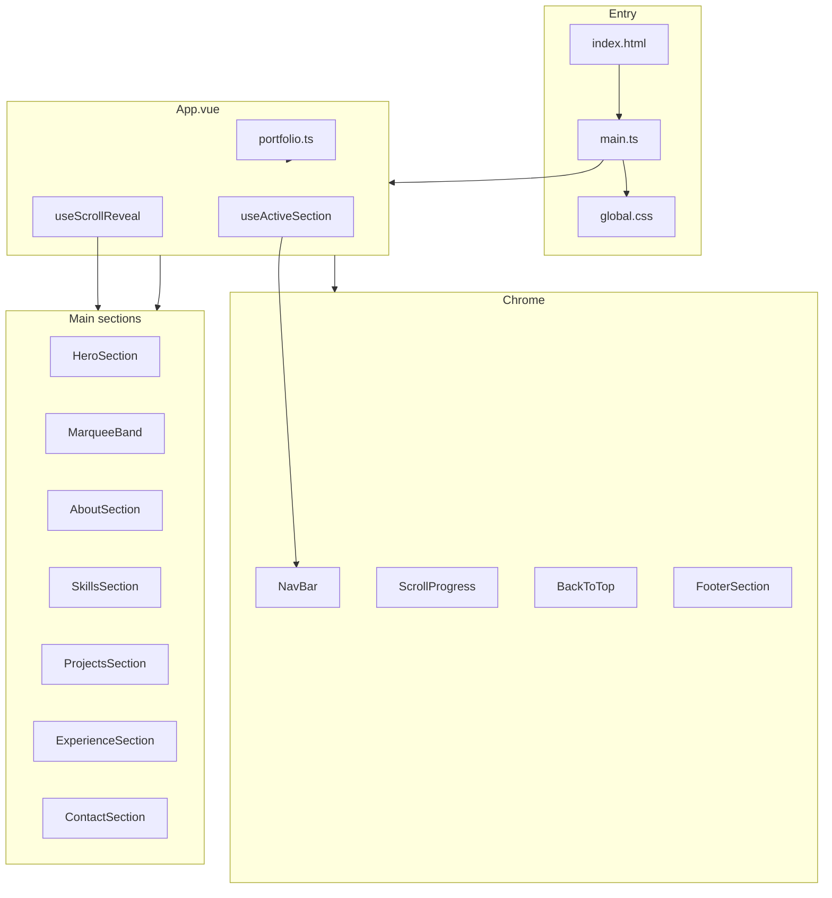

# Codebase documentation

This document describes how the **lesego-portfolio** project is organized, how data flows through the app, what each module does, and how to extend or maintain it without reading every file first.

For deployment steps, see [README.md](../README.md).

---

## Table of contents

1. [Overview](#overview)
2. [Technology stack](#technology-stack)
3. [Repository layout](#repository-layout)
4. [Runtime architecture](#runtime-architecture)
5. [Application bootstrap](#application-bootstrap)
6. [Data layer](#data-layer)
7. [Type system](#type-system)
8. [Composables](#composables)
9. [Components](#components)
10. [Styling and design tokens](#styling-and-design-tokens)
11. [Motion and accessibility](#motion-and-accessibility)
12. [Static assets and public files](#static-assets-and-public-files)
13. [Build tooling](#build-tooling)
14. [Scripts and workflows](#scripts-and-workflows)
15. [Extending the site](#extending-the-site)
16. [Conventions and design decisions](#conventions-and-design-decisions)
17. [Unused and legacy files](#unused-and-legacy-files)

---

## Overview

This is a **single-page portfolio** for Lesego Seritili. There is no Vue Router: navigation uses in-page anchor links (`#about`, `#projects`, etc.) and smooth scrolling.

The site is **content-driven**. Almost all copy, projects, skills, and experience live in one file: `src/data/portfolio.ts`. Vue components are responsible for **presentation and interaction** only.

Design goals:

- **Mobile-first** layout and touch-friendly controls
- **Editorial** typography (large headings, list-based projects)
- **Scroll-driven** feedback (progress bar, section highlighting, reveal animations)
- **Static hosting** on GitHub Pages with a subpath base (`/lesego/`)

---

## Technology stack

| Layer | Choice | Role |
|--------|--------|------|
| UI framework | Vue 3 (Composition API, `<script setup>`) | Components and reactivity |
| Language | TypeScript | Types for portfolio data and props |
| Bundler | Vite 8 | Dev server, production build, `@` alias |
| Vue SFC compiler | `@vitejs/plugin-vue` | `.vue` files |
| Dev tools | `vite-plugin-vue-devtools` | Optional in development |
| Type checking | `vue-tsc` | Validates `.vue` and `.ts` |
| Deploy | `gh-pages` | Pushes `dist/` to `gh-pages` branch |
| Package manager | Yarn (lockfile present) | Install and scripts |

There is **no** backend, database, or API. The app is fully static after `yarn build`.

---

## Repository layout

```
lesego-portfolio/
├── docs/
│   └── CODEBASE.md          # This file
├── public/                  # Copied as-is to dist root (no processing)
│   ├── favicon.svg
│   └── avatar.png
├── src/
│   ├── main.ts              # App entry: createApp, global CSS
│   ├── App.vue              # Root layout: shell + section order
│   ├── assets/
│   │   └── styles/
│   │       └── global.css   # Design tokens, utilities, reveal CSS
│   ├── components/          # Presentational sections and chrome
│   ├── composables/         # Reusable scroll/motion logic
│   ├── data/
│   │   └── portfolio.ts     # Single source of truth for content
│   └── types/
│       └── portfolio.ts     # TypeScript interfaces for portfolio data
├── index.html               # HTML shell, meta tags, #app mount
├── vite.config.ts           # Vite config (base path, alias, build)
├── tsconfig*.json           # TypeScript project references
├── package.json             # Scripts, homepage URL, dependencies
└── README.md                # Deploy and quick start
```

---

## Runtime architecture

The page is one vertical document. The root component wires global behavior once; sections receive props from `portfolio`.



**Data flow (simplified):**

1. `main.ts` mounts `App.vue` and loads global styles.
2. `App.vue` imports `portfolio` and passes slices as props to each section.
3. `useScrollReveal()` runs once and observes every `[data-reveal]` element in the DOM.
4. `useActiveSection()` tracks which section id is in view and passes `activeSection` to `NavBar`.
5. User interactions (filters, accordions, copy email, mobile menu) stay inside individual components.

---

## Application bootstrap

### `index.html`

- Sets `lang="en"`, viewport (including `viewport-fit=cover` for notched phones).
- SEO and Open Graph meta tags (title, description, `og:image` → `/avatar.png`).
- Single mount point: `<div id="app">`.
- Loads `/src/main.ts` as an ES module (Vite dev and build handle resolution).

**Note:** In production on GitHub Pages, asset URLs are prefixed with `/lesego/` via Vite `base`. Favicon and avatar in `public/` are served from the site root path relative to that base.

### `src/main.ts`

```ts
import { createApp } from 'vue'
import App from './App.vue'
import '@/assets/styles/global.css'

createApp(App).mount('#app')
```

No plugins, no Pinia, no router. Minimal surface area.

### `src/App.vue`

Responsibilities:

| Responsibility | Implementation |
|----------------|----------------|
| Content source | `import { portfolio } from '@/data/portfolio'` |
| Scroll reveal | `useScrollReveal()` on mount |
| Active nav section | `useActiveSection(sectionIds)` from `navLinks` hrefs |
| Marquee labels | `computed(() => portfolio.skills.map(s => s.name))` |
| Mobile menu state | `ref(false)` + `v-model:menu-open` on `NavBar` |

Section order (fixed):

1. `HeroSection` (`#top` is only on hero; nav links use `#about`, etc.)
2. `MarqueeBand`
3. `AboutSection` → `#about`
4. `SkillsSection` → `#skills`
5. `ProjectsSection` → `#projects`
6. `ExperienceSection` → `#experience`
7. `ContactSection` → `#contact`
8. `FooterSection`

---

## Data layer

### `src/data/portfolio.ts`

Exports a single object: `portfolio`, typed as `PortfolioData`.

**What belongs here**

- Name, title, tagline, email, location
- About paragraphs and sidebar highlights
- Navigation links and social links
- Skills (with one or more categories each)
- Projects (descriptions, tags, optional `liveUrl` / `repoUrl`, `featured` flag)
- Experience entries (role, company, period, description, optional `companyUrl`)

**What does not belong here**

- Layout or styling
- Component-specific UI state

**Typical edits**

- Add a project: push a new object into `projects`.
- Change job history: edit `experience`.
- Update email or links: top-level fields and `socialLinks`.

The `featured` flag on projects is still in the data model; the current UI uses an accordion list for all projects and does not visually separate featured items. You can use the flag later for filtering or styling.

### `src/types/portfolio.ts`

Defines contracts so `portfolio.ts` and components stay aligned:

| Type | Purpose |
|------|---------|
| `NavLink` | `{ label, href }` for header navigation |
| `SocialLink` | `{ label, href, icon }` where `icon` is a fixed union |
| `SkillCategory` | `'frontend' \| 'backend' \| 'tools' \| 'other'` |
| `Skill` | `{ name, categories[] }` supports full-stack skills |
| `Project` | Project card/row content and optional URLs |
| `Experience` | Job timeline entry |
| `AboutHighlight` | Sidebar facts; optional `href` for links |
| `PortfolioData` | Root shape for the whole site content |

When adding fields, update the interface first, then `portfolio.ts`, then any component props if needed.

---

## Composables

Composables live in `src/composables/` and encapsulate browser APIs and lifecycle.

### `useScrollReveal.ts`

**Purpose:** Fade/slide in elements as they enter the viewport.

**Mechanism:**

1. On mount, finds all `[data-reveal]` elements.
2. Uses `IntersectionObserver` with `threshold: 0.12` and bottom `rootMargin: -48px`.
3. When visible, calls `revealElement()` which:
   - Sets inline `opacity` and `transform` (survives Vue re-renders better than class-only toggles)
   - Sets `data-revealed="true"`
4. Unobserves each element after reveal (one-shot animation).

**CSS partnership:** `global.css` defines initial hidden state for `[data-reveal]` and revealed state for `[data-reveal][data-revealed='true']`.

**Usage:** Call once in `App.vue`. Mark any element with `data-reveal` in section templates. Do not put `data-reveal` on nodes that re-render in ways that reset inline styles unless they are wrappers that do not change class bindings aggressively.

### `useActiveSection.ts`

**Purpose:** Drive active state in the navigation for the section currently in view.

**Input:** Array of section DOM ids (from `navLinks`, e.g. `about`, `skills`, …).

**Mechanism:**

- Resolves `document.getElementById` for each id.
- `IntersectionObserver` with a narrow vertical band (`rootMargin: -35% 0 -45% 0`) so the “active” section is roughly what the user is reading.
- Picks the intersecting entry with highest `intersectionRatio`.
- Returns `{ activeSection }` ref (string id).

**Note:** Hero uses `id="top"` but is not in `navLinks`, so it is not part of active tracking.

### `useMotionPreference.ts`

**Purpose:** Respect user/OS motion settings and detect touch devices.

**Returns:**

- `reduceMotion` — `prefers-reduced-motion: reduce`
- `coarsePointer` — `pointer: coarse` (typical phones/tablets)

**Usage:** Available for components that should disable hover-only effects (e.g. 3D tilt). Currently wired where pointer-specific behavior matters; marquees and CSS animations also honor reduced motion in stylesheets.

---

## Components

All section components use `<script setup lang="ts">` and scoped CSS unless noted.

### Chrome (global UI)

#### `NavBar.vue`

- **Props:** `name`, `navLinks`, `activeSection`
- **Model:** `menuOpen` (boolean) for mobile drawer
- **Behavior:**
  - Desktop (`min-width: 769px`): horizontal links, uppercase small type
  - Mobile: “Menu” / “Close” pill; full-screen slide-in link list
  - `watch(menuOpen)` sets `document.body.style.overflow` to prevent background scroll when open
  - Active link styling when `activeSection` matches link hash
- **Logo:** Links to `#top`

#### `ScrollProgress.vue`

- Fixed 3px bar at top of viewport
- Width = scroll percentage of document
- Updates on `window` scroll (passive listener)

#### `BackToTop.vue`

- Appears after `scrollY > 500`
- Smooth scroll to top on click
- Position respects `safe-area-inset-bottom` on mobile

#### `FooterSection.vue`

- Minimal footer: name + copyright line

---

### `HeroSection.vue`

- **Props:** `name`, `title`, `tagline`
- **Section id:** `top`
- **Content:** Editorial hero: `// portfolio · {title}`, large split name (solid + stroked surname), lead tagline, short “digital space” paragraph, text-link CTAs to `#projects` and `#contact`, small avatar + location line
- **Motion:** Elements use `data-reveal` (handled globally)
- **Scroll hint:** Vertical “Scroll” link to `#about` (hidden on very small layouts in some breakpoints)

---

### `MarqueeBand.vue`

- **Props:** `items: string[]` (skill names from `App.vue`)
- **Behavior:** Two horizontal tracks, CSS infinite animation (forward + reverse)
- **Accessibility:** `aria-hidden="true"` (decorative)
- **Reduced motion:** Animations disabled in CSS when `prefers-reduced-motion: reduce`

---

### `AboutSection.vue`

- **Props:** `about: string[]`, `highlights: AboutHighlight[]`
- **Section id:** `about`
- **Layout:** Mobile: stacked; desktop: prose + sidebar list
- **First paragraph:** Styled as lead paragraph
- **Highlights:** Optional link for values with `href` (e.g. Quechua Group)

---

### `SkillsSection.vue`

- **Props:** `skills: Skill[]`
- **Section id:** `skills`
- **State:** `activeFilter` — `all` | category
- **UI:** Filter pills (horizontal scroll on mobile); list rows with skill name + category string (`frontend · backend`)
- **Logic:** `filteredSkills` computed filters by `categories.includes(filter)`

---

### `ProjectsSection.vue`

- **Props:** `projects: Project[]`
- **Section id:** `projects`
- **UI pattern:** Editorial accordion list (not a card grid)
  - Each row: index `01`, title, `+` / `−` toggle
  - Panel: description, tags, “Live site” / “Repository” links (`link-arrow` class)
- **State:** `activeIndex: number | null` — which row is expanded
- **Links:** External; `target="_blank"`, `rel="noopener noreferrer"`

---

### `ExperienceSection.vue`

- **Props:** `experience: Experience[]`
- **Section id:** `experience`
- **UI:** Accordion timeline; default expanded index `0` (most recent job)
- **Company names:** Link when `companyUrl` is set (click does not toggle accordion)

---

### `ContactSection.vue`

- **Props:** `email`, `socialLinks`
- **Section id:** `contact`
- **Email:** Large clickable text; `navigator.clipboard.writeText` with “Copied” feedback; fallback `mailto:`
- **Social:** Text links with arrow icons (labels from data)

---

## Styling and design tokens

### `src/assets/styles/global.css`

Central **design system** for the app:

| Token / utility | Meaning |
|-----------------|--------|
| `--color-bg` | Page background (`#08070b`) |
| `--color-text` / `--color-text-muted` | Primary and secondary text |
| `--color-accent` | Brand accent (coral) |
| `--font-display` | Space Grotesk |
| `--font-body` | DM Sans |
| `--section-y` | Vertical section padding (responsive) |
| `--nav-height` | Fixed header height |
| `--safe-bottom` | iOS safe area |

**Global utilities:**

- `.section-container` — max width + horizontal padding
- `.section-label` — `//`-style labels (often with `<em>//</em>` in templates)
- `.section-title` — large display headings; `.section-title--stroke` for outline text
- `.btn-text`, `.link-arrow` — editorial text links
- `.tag` — pill tags for tech stacks
- `[data-reveal]` — scroll reveal initial/revealed states

**Body grain:** `body::before` fixed noise overlay for texture.

Components use **scoped** styles for layout unique to that section; shared patterns rely on global classes and CSS variables.

---

## Motion and accessibility

| Feature | Behavior |
|---------|----------|
| Smooth scroll | `html { scroll-behavior: smooth; scroll-padding-top: nav height }` |
| Scroll reveal | IntersectionObserver + CSS transitions |
| Marquee | CSS keyframes; disabled when reduced motion preferred |
| Mobile menu | Body scroll lock; large touch targets (44px min in several controls) |
| Focus | Native focus on buttons and links; no custom focus trap in menu |
| Semantic structure | Headings per section; `aria-expanded` on accordions where implemented |
| External links | `rel="noopener noreferrer"` |

**Improvements you might add later:** focus trap in mobile nav, skip link, explicit `aria-controls` on project/experience toggles.

---

## Static assets and public files

Files in `public/` are copied to the **root of `dist/`** with unchanged paths (relative to Vite `base`):

| File | Use |
|------|-----|
| `favicon.svg` | Browser tab icon |
| `avatar.png` | Hero thumbnail, Apple touch icon, OG image reference |

Referenced in templates as `/avatar.png` and in `index.html` as `/favicon.svg`. Vite rewrites these for production base path during build.

---

## Build tooling

### `vite.config.ts`

| Option | Value | Why |
|--------|--------|-----|
| `base` | `'/lesego/'` | GitHub Pages project site URL |
| `plugins` | `vue()`, `vueDevTools()` | SFC support + devtools |
| `resolve.alias` | `@` → `./src` | Short imports |
| `build.sourcemap` | `true` | Easier production debugging |
| `rollupOptions.output` | Flat `assets/[name].js` | Predictable asset names |

### TypeScript

- Project references: root `tsconfig.json` → `tsconfig.app.json` + `tsconfig.node.json`
- App config: `noUncheckedIndexedAccess: true` for safer array/object access
- Path `@/*` mirrors Vite alias

### `env.d.ts`

References Vite client types for `import.meta` and static asset imports.

---

## Scripts and workflows

| Script | Command | Description |
|--------|---------|-------------|
| Dev | `yarn dev` | Vite dev server, HMR |
| Build | `yarn build` | `vue-tsc --build` then `vite build` |
| Preview | `yarn preview` | Serve `dist` locally |
| Deploy | `yarn deploy` | `predeploy` runs build; `gh-pages -d dist` |

See [README.md](../README.md) for GitHub Pages branch settings and troubleshooting.

---

## Extending the site

### Add a new content section

1. Add `NavLink` in `portfolio.ts` → `navLinks` (e.g. `{ label: 'Blog', href: '#blog' }`).
2. Create `BlogSection.vue` with matching `id="blog"` on the `<section>`.
3. Import and place it in `App.vue` (order = scroll order).
4. Pass props from `portfolio` or extend `PortfolioData` with a new array field.

`useActiveSection` automatically includes new ids if they come from `navLinks`.

### Add a project

Add an object to `portfolio.projects` with at least `title`, `description`, `tags`. Optional `liveUrl`, `repoUrl`, `featured`.

### Add a skill

Add to `portfolio.skills` with one or more `categories`. Marquee updates automatically via `App.vue` computed list.

### Change site URL (different repo name)

1. Update `vite.config.ts` → `base: '/your-repo/'`
2. Update `package.json` → `homepage`
3. Redeploy

### Introduce Vue Router

Not required today. If you add it later:

- Move sections to routes or keep one page and use router only for `/blog/:slug`
- Adjust `useActiveSection` or replace with `route.meta`
- Set Vite `base` the same way for GitHub Pages

---

## Conventions and design decisions

1. **Single content file** — Non-developers can edit copy in one place with TypeScript catching shape errors.
2. **No global state store** — Section UI state is local; only nav menu and composable refs are shared from `App.vue`.
3. **Inline styles for reveal** — Avoids Vue patch removing one-shot `revealed` classes on re-render.
4. **Anchor navigation** — Works on static hosting without server rewrite rules (except SPA fallback, not needed for single page).
5. **Composition API only** — No Options API; `<script setup>` for less boilerplate.
6. **Scoped CSS** — Component styles default to scoped; globals only in `global.css`.
7. **Editorial UI** — Projects/experience as lists and accordions rather than dense card grids (mobile-first readability).

---

## Unused and legacy files

| File | Status |
|------|--------|
| `src/components/AmbientMotion.vue` | **Not imported** in current `App.vue`. Optional floating orbs background from an earlier design. Safe to delete or re-enable in `App.vue` if you want parallax blobs again. |

If you re-enable `AmbientMotion`, place it once near the root of `App.vue` (before main content) and ensure `z-index` stays below interactive UI.

---

## Quick reference: section DOM ids

| Id | Component |
|----|-----------|
| `top` | Hero (not in nav) |
| `about` | AboutSection |
| `skills` | SkillsSection |
| `projects` | ProjectsSection |
| `experience` | ExperienceSection |
| `contact` | ContactSection |

Nav hash links must match these ids exactly.

---

## Summary

The codebase is a **small, static Vue application**: one data module, typed models, a handful of composables for scroll behavior, and section components that map closely to portfolio content. Most day-to-day updates are edits to **`src/data/portfolio.ts`**; structural changes go through **`App.vue`**, **`portfolio.ts` types**, and optionally **global.css** for design-wide tweaks.

For deployment, see [README.md](../README.md).
